# Архитектура Runner

Platform владеет назначением попыток, переходами состояния и реестром доказательств. Runner управляет диалогом и сетью, Environment владеет CRM, а Intelligence управляет синтетическим клиентом и оценкой.

| Пакет | Ответственность |
|---|---|
| `cmd/runner`, `internal/config` | Сборка зависимостей, сигналы, конфигурация и диагностика |
| `internal/worker` | Durable pull consumer, слоты, продление AckWait, подтверждения |
| `internal/execution` | Lease, валидация frozen plan, диалог, лимиты, NDJSON и manifest |
| `internal/platform` | gRPC Control, подписанный PUT, регистрация и проверка ссылок |
| `internal/transport` | HTTP-адаптер агента, транспорт PCM, политика исходящих адресов, CRM |
| `contracts` | Зафиксированные схемы, protobuf и fixture Platform |

```mermaid
sequenceDiagram
    participant B as JetStream
    participant R as Runner
    participant P as Platform
    participant I as Intelligence
    participant A as Agent
    participant E as Environment
    participant S as Object storage
    B->>R: poligon.cmd.session.execute.v1
    R->>P: ClaimExecution and GetRuntimePlan
    par Lease and broker renewal
        loop While claimed
            R->>P: HeartbeatExecution
            R->>B: InProgress
        end
    and Work
        R->>E: Initialize isolated attempt
        R->>I: Initialize simulator
        loop Client turn and tools
            R->>I: Next action
            R->>A: Client message or tool results
            R->>E: Allowlisted CRM call
        end
        par Runner journals
            R->>P: PrepareArtifactUpload
            R->>S: Signed PUT
            R->>P: RegisterArtifact
        and Environment evidence
            R->>E: Finalize attempt and obtain refs
        end
        R->>P: Resolve refs and register manifest
        R->>B: Terminal event
        B-->>R: PubAck
        R->>B: AckSync command
    end
```

Диаграмма показывает порядок действий при наличии симулятора Intelligence и финализации Environment. В текущем бинарнике эти этапы недоступны. Статус доступности интеграций указан в [integration.md](integration.md).

## Жизненный цикл и отказоустойчивость

1. Слот принимает одну команду, проверяет envelope и передаёт в Platform свежий UUID worker. Ошибку claim или превышение квоты возвращает в durable consumer с задержкой. Устаревшие и отменённые до claim команды подтверждает после ответа Platform.
2. После claim отдельная горутина продлевает 30-секундный lease каждые 10 секунд и прерывает контекст работы при отзыве или истечении. Транзиентный сбой heartbeat допускает повтор до исходного срока lease. Другая горутина продлевает AckWait JetStream.
3. Движок сверяет ref, контекст, JCS SHA-256 и схемы. В процессе подготовки и диалога действует дедлайн frozen plan. Отмена Platform прекращает новые действия и сохраняет время на выгрузку доказательств под действующим lease.
4. Слот обрабатывает ответы, запросы к CRM и события последовательно. Журнал пишется перед live progress и позволяет Platform восстановить пропущенные записи. Несколько tool calls из одного ответа выполняются по порядку.
5. Runner закрывает попытку в Environment параллельно с загрузкой своих журналов. После проверки ссылок он регистрирует manifest при полном наборе доказательств. Терминальный envelope повторно публикуется с теми же байтами и ID при потере PubAck. AckSync исходной команды выполняется после PubAck. Platform дедуплицирует события в inbox и решает, разрешён ли следующий attempt.
6. При SIGTERM прекращаются новые pull-запросы. После интервала drain отменяются активные контексты. Потерявший lease Runner не публикует терминальный результат. Platform Supervisor закрывает попытку и при наличии права назначает следующую. Начатая CRM-операция может завершиться на стороне Environment уже после сетевой отмены.

| Сбой | Поведение |
|---|---|
| Сбой NATS | Переподключение. При удалении durable Runner прекращает pull, даёт активным слотам завершиться в пределах drain и повторно привязывает consumer. Временная потеря progress покрывается NDJSON. При потере terminal PubAck команда возвращается в очередь |
| Повтор команды | Platform отклоняет claim другого worker, устаревшую попытку или попытку в терминальном состоянии |
| Отзыв lease | Прерываются запросы и новые действия. Platform закрывает истёкшую попытку |
| CRM 409/429/500/504 | Исходный статус и тело возвращаются агенту. Записи запроса и результата сохраняются |
| CRM transport timeout | Агент получает ошибку без предположений о состоянии операции |
| Ошибка протокола агента | Терминация `agent_protocol_error` с возможностью оценки при полном наборе доказательств |
| Лимит реплик, инструментов, времени или стоимости | Терминация с соответствующей причиной. Полнота сведений о стоимости помечается в usage |
| Сбой загрузки или регистрации | Ошибка исполнения и ссылки на уже зарегистрированные журналы в terminal payload |
| Недоступный контракт | Явное завершение с ошибкой зависимости и `retryable=false` для известного отсутствия реализации |

## Ограничения ресурсов

На активную попытку приходится один слот, один монитор lease и один монитор брокера. Нет очереди ожидающих сессий в памяти Runner. Команды ожидают в JetStream, а `MaxAckPending` ограничивает неподтверждённые сообщения одного durable для всех реплик. Остальные ограничения потока задаются настройками stream Platform.

NDJSON записывается двумя буферами по 4 КиБ и хешируется в процессе записи. Строка вместе с переводом строки занимает до 64 КиБ, чтобы Platform могла восстановить её из журнала. Поток PUT читает файл без загрузки целиком в память. Максимум записи на живой слот равен `RUNNER_MAX_EVIDENCE_BYTES` плюс маленький manifest. Размещайте временный каталог на томе с квотой. При штатной остановке журналы удаляются. При аварийном завершении ОС файлы могут остаться до очистки временного тома.

Длительность, число реплик, число CRM-операций и размеры данных ограничены на входе. Встроенные счётчики использования и суммарных длительностей не требуют хранения истории в памяти. HTTP использует отдельный общий пул для агентов и для внутренних сервисов. gRPC использует один канал.
